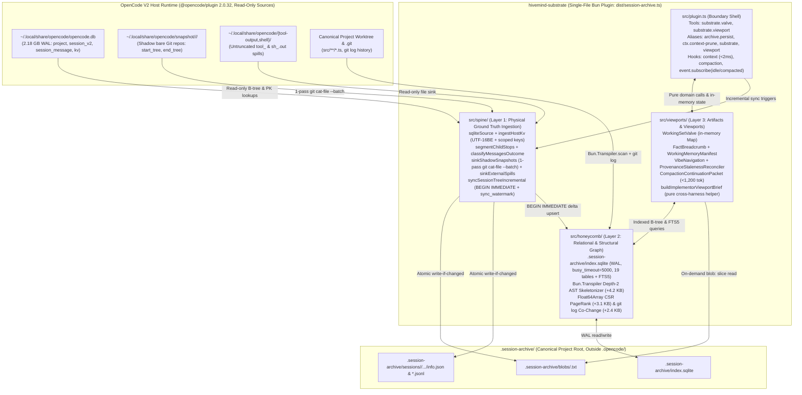

# Deep module design for `hivemind-substrate`

- **Artifact:** `.planning/architecture/DEEP-MODULE-DESIGN.md`
- **Scope:** `E1.1 trajectory-working-memory`, `E1.2 codebase-structural-graph`, `E1.3 viewport-synthesis-compaction`
- **Status:** `approved-in-WF-SUB-08`
- **Date:** `2026-10-18`
- **Author:** Architect & Codebase-Design Specialist (`0fb5917a-3b5d-4f8e-a7a3-2bfdf37c94c2`)
- **Requirements:** `REQ-SUB-01..18`
- **ADR Linkage:** [`ADR-001`](file:///Users/MAC/Documents/coding-projects/hivemind-substrate/.planning/architecture/ADR-001-three-layer-context-substrate.md), [`ADR-002`](file:///Users/MAC/Documents/coding-projects/hivemind-substrate/.planning/architecture/ADR-002-step-watermark-valve-and-breadcrumb-handles.md), [`ADR-003`](file:///Users/MAC/Documents/coding-projects/hivemind-substrate/.planning/architecture/ADR-003-bun-native-codebase-structural-graph.md)
- **Primary Evidence:** [`WF-SUB-01`](file:///Users/MAC/Documents/coding-projects/hivemind-substrate/.planning/wayfinder/tickets/WF-SUB-01-semantic-session-digest-and-vibe-navigation.md), [`WF-SUB-02`](file:///Users/MAC/Documents/coding-projects/hivemind-substrate/.planning/wayfinder/tickets/WF-SUB-02-intra-turn-step-watermark-and-breadcrumb-valve.md), [`WF-SUB-03`](file:///Users/MAC/Documents/coding-projects/hivemind-substrate/.planning/wayfinder/tickets/WF-SUB-03-spine-kv-snapshot-and-spill-ingestion.md), [`WF-SUB-04`](file:///Users/MAC/Documents/coding-projects/hivemind-substrate/.planning/wayfinder/tickets/WF-SUB-04-incremental-sync-and-hook-latency-budget.md), [`WF-SUB-05`](file:///Users/MAC/Documents/coding-projects/hivemind-substrate/.planning/wayfinder/tickets/WF-SUB-05-bun-transpiler-depth2-ast-skeletonizer.md), [`WF-SUB-06`](file:///Users/MAC/Documents/coding-projects/hivemind-substrate/.planning/wayfinder/tickets/WF-SUB-06-pagerank-repomap-and-git-cochange-couplings.md), [`WF-SUB-07`](file:///Users/MAC/Documents/coding-projects/hivemind-substrate/.planning/wayfinder/tickets/WF-SUB-07-compaction-continuity-and-provenance-reconciler.md), [`WF-SUB-08`](file:///Users/MAC/Documents/coding-projects/hivemind-substrate/.planning/wayfinder/tickets/WF-SUB-08-substrate-surface-and-cross-harness-switching-grill.md)

## Consumer and maintainer impact

**Consumer impact.** Human operators and orchestrator agents run 45-step single-prompt autonomous turns, cross-harness child delegations (`OpenCode`, `Devin`, `Antigravity`), and multi-compaction sessions without context-window exhaustion or post-prune amnesia. Measured replay on [`session-bcad339b`](file:///var/folders/wn/mt1t2bp52rl0pttbgq6bmswh0000gn/T/session-bcad339b-471f-456c-8815-eb205e6c929b.json) (`S1 msg[45]`) frees `154,900` tokens (`-60.2%` of active context) where legacy `context-prune` freed `0` bytes ([`WF-SUB-02`](file:///Users/MAC/Documents/coding-projects/hivemind-substrate/.planning/wayfinder/tickets/WF-SUB-02-intra-turn-step-watermark-and-breadcrumb-valve.md)). Measured replay on [`session-a35adea6`](file:///var/folders/wn/mt1t2bp52rl0pttbgq6bmswh0000gn/T/session-a35adea6-83a7-439f-90b1-f15793b79239.json) (`S2 msg[123]`) frees `78,151` tokens and prevents the subsequent `37,882`-token panic re-read loop across `14` file reads and `7` skill invocations ([`WF-SUB-02`](file:///Users/MAC/Documents/coding-projects/hivemind-substrate/.planning/wayfinder/tickets/WF-SUB-02-intra-turn-step-watermark-and-breadcrumb-valve.md)). Natural-language queries locate prior root trajectories and user intent pivots in `0.49..1.12 ms` median (`483` tokens) instead of `30,331` characters of Python JSONL shell scrapes ([`WF-SUB-01`](file:///Users/MAC/Documents/coding-projects/hivemind-substrate/.planning/wayfinder/tickets/WF-SUB-01-semantic-session-digest-and-vibe-navigation.md)).

**Maintainer impact.** Future engineers inherit one self-contained TypeScript package (`dist/session-archive.ts`, zero external runtime dependencies, `+9.7 KB` structural graph code) divided into four deep modules (`src/spine/`, `src/honeycomb/`, `src/viewports/`, `src/plugin.ts`) over one WAL SQLite database (`.session-archive/index.sqlite`). Three disconnected plugin silos (`src/archive/`, `.opencode/plugins/context-prune.ts`, `.opencode/plugins/compaction-continuity.ts`) and their `.opencode/compaction-history/*.jsonl` hot-reload hazards are retired in one wave (`principle-migrate-callers-then-delete-legacy-apis`).

## Requirement traceability (`REQ-SUB-01..18`)

| Requirement ID | Phase | Summary | Owning Module | Verification Gate & Prototype Proof |
|---|---|---|---|---|
| `REQ-SUB-01` | `E1.1` | Read-only host `opencode.db` (`project`, `session_v2`, `session_message`, `kv`) access with upfront schema drift validation | `src/spine/` | `WF-SUB-03`, `WF-SUB-04` (`sqliteSource` + `ingestHostKv`) |
| `REQ-SUB-02` | `E1.1` | Host `kv` decoding for UTF-16BE `plugin:<hex>:<key>` and scoped keys (`bindings/v1/*`, `delegate-mode/child/*`, `context-prune:*`) | `src/spine/` | `WF-SUB-03` (`618` host `kv_binding` rows decoded) |
| `REQ-SUB-03` | `E1.1` | Multi-stop child segmentation keyed by `(parent_session_id, call_id, turn_index)` preserving `spawn`, `send`, and `continue` turns | `src/spine/` | `WF-SUB-03` (`124` `delegation_turn` rows across multi-stop children) |
| `REQ-SUB-04` | `E1.1` | `ReportedOutcome` vs `VerifiedOutcome` classifier (`clean`, `tool_error_inside`, `blocked_in_text`, `verified_passed`, `verified_stale_by_later_touch`) | `src/spine/` | `WF-SUB-03` (`11/11` false-positive Antigravity `succeeded` turns caught) |
| `REQ-SUB-05` | `E1.1` | Shadow snapshot Git tree blob extraction (`start_tree:path`, `end_tree:path`) via 1-pass `git cat-file --batch` before 7-day `git gc` | `src/spine/` | `WF-SUB-03` (`43.89 ms` median, `464` `snapshot_artifact` rows, `SPEC.md` drafts recovered) |
| `REQ-SUB-06` | `E1.1` | External `tool-output/tool_<callID>` and `shell/<callID>.txt` spill file sinking + full user prompt blob sinking (`user.text`) | `src/spine/` | `WF-SUB-01`, `WF-SUB-03` (`21` spills sunk up to `181.5 KB`) |
| `REQ-SUB-07` | `E1.1` | Watermark-gated incremental SQLite sync (`sync_watermark`, `BEGIN IMMEDIATE`, `busy_timeout = 5000`) completing in `< 150 ms` | `src/spine/` | `WF-SUB-04` (`1.90 ms` warm no-op, `3.72 ms` 1-turn delta, `14.35 ms` snapshot delta, `0` `SQLITE_BUSY`) |
| `REQ-SUB-08` | `E1.1` | Semantic session digest (`session_semantic_digest`), 9-category `intent_pivot` index, and compound-token FTS5 (`substrate_fts`) | `src/honeycomb/` | `WF-SUB-01`, `WF-SUB-07` (`0.49..1.12 ms` median FTS5 root-coverage ranking) |
| `REQ-SUB-09` | `E1.1` | Hybrid `WorkingSetValve` with explicit `keepRecentSteps = 8`, `"recent"` single-prompt fallback, and automatic `65%` window watermark (`keepRecentSteps = 12`) | `src/viewports/` | `WF-SUB-02`, `WF-SUB-08` Q2 (`154,900` tokens freed in `S1 msg[45]`) |
| `REQ-SUB-10` | `E1.1` | Content-addressed `FactBreadcrumb` replacement (`blob:<sha256>`) and Do-Not-Reread `WorkingMemoryManifest` (`FRESH` vs `STALE`, `ACTIVE` skills) | `src/viewports/` | `WF-SUB-02` (`14/14` re-read files and `7/7` re-invoked skills prevented in `S2`) |
| `REQ-SUB-11` | `E1.1` | Strictly in-memory `ctx.session.hook("context", ...)` execution in `< 2 ms` (`0` SQLite queries, `0` disk I/O, `0` hashing on critical path) | `src/viewports/` | `WF-SUB-02`, `WF-SUB-04` (`0.0150 ms` median on `S1`, `0.0337 ms` median on `S2`) |
| `REQ-SUB-12` | `E1.2` | Zero-dependency `Bun.Transpiler.scan()` + Depth-2 closure-factory AST skeletonizer (`>= 88%` compression, `< 30 ms` warm parse) | `src/honeycomb/` | `WF-SUB-05` (`89.09%` reduction on `51` files, `61` Depth-2 symbols in `createNativeDelegationDriver`, `24.70 ms` warm) |
| `REQ-SUB-13` | `E1.2` | Pure-TS `Float64Array` CSR PageRank (`20` iterations, `d = 0.85`) and Tier-1 `RepoMap` renderer (`< 1,000` tokens, `< 5 ms`) | `src/honeycomb/` | `WF-SUB-06` (`0.216 ms` solve, `910` tokens in `1.306 ms` median) |
| `REQ-SUB-14` | `E1.2` | `git log -n 500` temporal co-change miner (`max_files_per_commit <= 15`) and incremental `HEAD~1..HEAD` updater surfacing hidden couplings (`has_static_edge = 0`) | `src/honeycomb/` | `WF-SUB-06` (`103.89 ms` cold, `8.53 ms` incremental, `devin-executable <-> harness-antigravity` `66.7%` hidden coupling) |
| `REQ-SUB-15` | `E1.3` | Unified `substrate.valve` and `substrate.viewport` tools with backwards-compatible aliases (`archive.persist`, `ctx.context-prune`, `substrate`, `viewport`) and optional `sessionID` resolution | `src/plugin.ts` | `WF-SUB-07`, `WF-SUB-08` Q1 (`resolveDefaultSessionId` eliminates `S1 msg[58]` failure) |
| `REQ-SUB-16` | `E1.3` | `ProvenanceChain` table (`Finding -> Decision -> FileTouch/Commit -> VerificationReceipt`) and live disk-hash staleness reconciler (`reconcileProvenanceStaleness`) | `src/viewports/` | `WF-SUB-07` (`0.1704 ms` median reconciliation, deterministic `VERIFIED_FRESH <-> verified_stale_by_later_touch` transitions) |
| `REQ-SUB-17` | `E1.3` | SQLite-backed `compaction` hook synthesizing a `< 1,200`-token `CompactionContinuationPacket` in `< 2 ms` (plus `< 150 ms` delta sync) and retiring `.opencode/compaction-history/*.jsonl` | `src/viewports/` | `WF-SUB-07` (`747..1,038` tokens across all 7 real compactions, `0.3472 ms` median synthesis) |
| `REQ-SUB-18` | `E1.3` | Pure exported cross-harness helper `buildImplementorViewportBrief(db, options)` packing write lease, Tier-2 `AstSkeleton`s, `SymbolSlice`s, and `CoChangeCoupling` alerts for child delegation | `src/viewports/` | `WF-SUB-05`, `WF-SUB-06`, `WF-SUB-08` Q3 |

---

## Phase A. Grounding (`how` and `why`)

### 1. Problem statement and historical failure evidence

Running [`src/plugin.ts`](file:///Users/MAC/Documents/coding-projects/hivemind-substrate/src/plugin.ts), [`.opencode/plugins/context-prune.ts`](file:///Users/MAC/Documents/coding-projects/hivemind-substrate/.opencode/plugins/context-prune.ts), and [`.opencode/plugins/compaction-continuity.ts`](file:///Users/MAC/Documents/coding-projects/hivemind-substrate/.opencode/plugins/compaction-continuity.ts) as three disconnected plugins produced four compounding failures in production OpenCode V2 trajectories ([`WF-SUB-R01`](file:///Users/MAC/Documents/coding-projects/hivemind-substrate/.planning/wayfinder/research/WF-SUB-R01-forensic-dual-plugin-collision.md), [`WF-SUB-R02`](file:///Users/MAC/Documents/coding-projects/hivemind-substrate/.planning/wayfinder/research/WF-SUB-R02-host-storage-kv-snapshots-spills.md)):

1. **Zero-byte intra-turn prune (`S1 msg[45]`).** In [`context-prune.ts`](file:///Users/MAC/Documents/coding-projects/hivemind-substrate/.opencode/plugins/context-prune.ts#L111-L115), both `"recent"` and `"initial"` modes slice `event.messages` at `findLastIndex(m => m.role === "user")`. During the 44-step single-prompt autonomous run in `ses_eb2eabb14ffeCXsCwb845rtffb`, `msg[0]` was the only user message, so `context-prune` thinned `0` parts and freed `0` bytes. Six steps later (`msg[51]`, `274,175` input tokens), the session hit hard auto-compaction.
2. **Post-prune and post-compaction panic re-read spirals (`S1 msg[52..63]` and `S2 msg[123..130]`).** In `S1 msg[58]`, calling `compaction_continuity({ action: "intents" })` without `sessionID` failed with `"Specify action and sessionID for compaction_continuity."` ([`compaction-continuity.ts`](file:///Users/MAC/Documents/coding-projects/hivemind-substrate/.opencode/plugins/compaction-continuity.ts#L649-L690)), causing the agent to re-load `16` skills and re-read `28` files (`163,972` chars). In `S2 msg[123]`, `context-prune` replaced `53` tool outputs (`311,570` chars) with generic `"rerun the tool"` stubs and wiped skill bodies, causing the agent to re-read `14` file slices and `7` skills (`151,528` chars) before exhausting provider quota at `msg[135]`.
3. **Write-only archive and Python shell scraping (`S2 msg[122..125]`).** Because [`src/plugin.ts`](file:///Users/MAC/Documents/coding-projects/hivemind-substrate/src/plugin.ts#L28-L78) exposed only `archive.persist` and keyed `.session-archive/` by opaque `ses_...` IDs without semantic digests or query tools, the agent shelled out with `head -c 1600` and an inline Python JSONL script (`30,331` tool-output chars across `msg[124..125]`).
4. **Uncaptured host lineage, false-positive child completions, and ephemeral snapshots (`WF-SUB-R02`).** [`src/archive/source.ts`](file:///Users/MAC/Documents/coding-projects/hivemind-substrate/src/archive/source.ts) ignored `opencode.db` table `kv` (`1,638` rows holding foreign ACP bindings), overwrote multi-stop child turns, trusted host `idle.outcome = "succeeded"` across `11` Antigravity children that actually failed with tool errors or `BLOCKED` text, and ignored uncommitted drafts in `~/.local/share/opencode/snapshot/` and full logs in `~/.local/share/opencode/tool-output/` and `shell/` subject to 7-day retention pruning.

### 2. Traced runtime architecture and boundary model



### 3. Runtime entry points, state ownership, and boundary constraints

1. **`ctx.session.hook("context", ...)` (Synchronous Critical Path, `< 2 ms` budget).**
   - **Owner:** `WorkingSetValve.applyContextHookInMemory` in `src/viewports/`.
   - **Data flow:** Reads only the in-memory `Map<SessionId, ArmedValveState>` and `event.messages`. Computes the token estimate (`ceil(chars / 4)`). If the valve is explicitly armed (`keepRecentSteps = 8`) or estimated input tokens exceed `65%` of the model context window (`keepRecentSteps = 12` auto-watermark per `WF-SUB-08` Q2), it slices `event.messages` at the `K`-th most recent `assistant` message inside the active compaction window, replaces completed non-delegation tool outputs before the watermark with precomputed `FactBreadcrumb` strings (`blob:<sha256>`), truncates oversized non-`KEEP_INPUT` tool inputs while preserving object keys, replaces inline `<skill_content>` blocks with active skill pointers, and prepends the `WorkingMemoryManifest` to `event.system`.
   - **Boundary constraint:** Zero SQLite queries, zero filesystem reads or writes, and zero subprocess spawns occur inside `context`. Measured latency is `0.0150 ms` median (`0.0357 ms` max) on `S1` and `0.0337 ms` median (`0.0448 ms` max) on `S2` ([`WF-SUB-02`](file:///Users/MAC/Documents/coding-projects/hivemind-substrate/.planning/wayfinder/tickets/WF-SUB-02-intra-turn-step-watermark-and-breadcrumb-valve.md)).
2. **`ctx.session.hook("compaction", ...)` (Pre-Compaction Continuity Gate, `< 150 ms` total budget).**
   - **Owner:** `syncSessionTreeIncremental` (`src/spine/`) + `reconcileProvenanceStaleness` and `buildCompactionContinuationPacket` (`src/viewports/`).
   - **Data flow:** Runs incremental delta sync (`3.72..14.35 ms` median), reconciles disk SHA-256 hashes against `file_read_ledger` and `provenance_chain` (`0.1704 ms` median), synthesizes the `< 1,200`-token `CompactionContinuationPacket` (`0.3472 ms` median, `747..1,038` tokens across all 7 real compactions), persists the row in `compaction_continuation_ledger`, and appends the structured continuity prompt contract and packet to `compaction.system` ([`WF-SUB-07`](file:///Users/MAC/Documents/coding-projects/hivemind-substrate/.planning/wayfinder/tickets/WF-SUB-07-compaction-continuity-and-provenance-reconciler.md)).
3. **`ctx.event.subscribe` (`session.status` `idle` and `session.compacted`).**
   - **Owner:** `SubstrateRuntimeCoordinator` (`src/plugin.ts` orchestrating `src/spine/`, `src/honeycomb/`, and `src/viewports/`).
   - **Data flow:** Ignores `running` and `busy` events (`0` queries). On `idle` or `session.compacted`, runs `syncSessionTreeIncremental` (`1.90..14.35 ms` median), updates incremental AST skeletons for modified `.ts`/`.tsx` files (`2.30 ms` warm skip, `3.48 ms` 1-file delta), updates `HEAD~1..HEAD` co-change counts if `.git/HEAD` advanced (`8.53 ms` median), and refreshes the in-memory `ArmedValveState` for the session ([`WF-SUB-04`](file:///Users/MAC/Documents/coding-projects/hivemind-substrate/.planning/wayfinder/tickets/WF-SUB-04-incremental-sync-and-hook-latency-budget.md), [`WF-SUB-05`](file:///Users/MAC/Documents/coding-projects/hivemind-substrate/.planning/wayfinder/tickets/WF-SUB-05-bun-transpiler-depth2-ast-skeletonizer.md), [`WF-SUB-06`](file:///Users/MAC/Documents/coding-projects/hivemind-substrate/.planning/wayfinder/tickets/WF-SUB-06-pagerank-repomap-and-git-cochange-couplings.md)).
4. **Tool Calls (`substrate.valve`, `substrate.viewport`, and Compatibility Aliases).**
   - **Owner:** `src/plugin.ts` dispatching to `src/viewports/`, `src/honeycomb/`, and `src/spine/`.
   - **Data flow:** Validates untrusted tool arguments at the plugin boundary (`principle-boundary-discipline`), resolves optional `sessionID` via `resolveDefaultSessionId` (`explicit_input -> hook_context -> sqlite_latest_root`), executes the requested valve or viewport operation, and returns both compact markdown for the LLM and structured metadata for programmatic callers.

### 4. Dependency classification (`codebase-design/DEEPENING.md`)

| Dependency | Category | Owning Module | Design & Test Strategy | Evidence Limit & Operational Constraint |
|---|---|---|---|---|
| `ArmedValveState`, `computeStepWatermark`, `FactBreadcrumb` formatting, `Bun.Transpiler.scan()` Depth-2 state machine, `Float64Array` CSR PageRank, `classifyMessagesOutcome`, `segmentChildStops` | **In-process computation / state** | `src/viewports/`, `src/honeycomb/`, `src/spine/` | Consolidate behind module entry points; exercise real algorithms in tests with zero mocks. | Static types do not prove token budgets or latency; test suites assert `< 2 ms` hook time, `< 1,200` compaction tokens, and `>= 88%` AST token reduction. |
| `~/.local/share/opencode/opencode.db` (`2.18 GB` WAL) and `.session-archive/index.sqlite` + `blobs/<sha256>.txt` | **Local-substitutable storage / filesystem** | `src/spine/`, `src/honeycomb/` | Use disposable temporary SQLite databases (seeded with verbatim OpenCode v2.0.32 DDL in `test/helpers.ts`) and temp `.session-archive/` directories in unit/e2e tests; opt-in `ARCHIVE_REAL_DB=1` against live host DB. | Never open `opencode.db` without `{ readonly: true }`. Never write under `.opencode/` (triggers host hot-reload). All `.session-archive/index.sqlite` writes use `BEGIN IMMEDIATE` + `PRAGMA busy_timeout = 5000`. |
| Shadow snapshot bare Git repos (`~/.local/share/opencode/snapshot/<project_id>/<sha1(dir)>/`) and workspace `.git` history | **Local-substitutable subprocess boundary (`git`)** | `src/spine/snapshots.ts`, `src/honeycomb/cochange.ts` | Encapsulate `git cat-file --batch` and `git log` behind narrow batch functions accepting an optional `GitBatchRunner` / repo path; test against disposable temporary bare Git repos and real repo fixtures. | Spawning `git` costs `~8..15 ms` on macOS arm64; must batch all object specifications into a single `git cat-file --batch` invocation per sync pass and never invoke `git` inside the `context` hook. |
| OpenCode V2 Host Plugin Runtime (`@opencode/plugin` `2.0.32`) | **Framework boundary shell** | `src/plugin.ts` | Keep `@opencode/plugin` imports strictly `import type`; test `plugin.setup(ctx)` with a lightweight in-memory `Plugin.Context` harness recording registered tools, hooks, and storage entries. | Host supplies `@opencode/plugin` at runtime; `dist/session-archive.ts` bundles zero external npm packages (`external: ["bun:*", "node:*", "@opencode/*"]`). |

---

## Caller usage first (`architect` Phase B / C)

### 1. OpenCode V2 plugin registration and tool surface (`src/plugin.ts`)

```ts
// File: src/plugin.ts
import type { Plugin } from "@opencode/plugin"
import { createSubstrateRuntime } from "./viewports/index.ts"

export {
  buildImplementorViewportBrief,
  type ImplementorBriefOptions,
  type ImplementorViewportBrief,
} from "./viewports/index.ts"

export default {
  id: "hivemind-substrate",
  async setup(ctx: Plugin.Context) {
    const runtime = await createSubstrateRuntime({
      projectID: ctx.location.project.id,
      projectRoot: ctx.location.project.canonical,
      worktreeDir: ctx.location.directory,
      archiveSubdir: typeof ctx.options.dir === "string" ? ctx.options.dir : ".session-archive",
      hostDbPath: typeof ctx.options.dbPath === "string" ? ctx.options.dbPath : undefined,
      codemode: ctx.options.direct !== true,
      autoPruneThresholdRatio: 0.65,
      autoPruneKeepRecentSteps: 12,
      explicitPruneKeepRecentSteps: 8,
      storage: ctx.storage,
    })

    // 1. Synchronous in-memory working-set valve (< 2 ms critical path, 0 SQLite queries)
    await ctx.session.hook("context", (event) => {
      runtime.onContextHook(event)
    })

    // 2. Pre-compaction incremental sync (< 150 ms) + < 1,200-token continuity packet
    await ctx.session.hook("compaction", async (compaction) => {
      await runtime.onCompactionHook(compaction)
    })

    // 3. Background incremental sync on turn idle and compaction completion
    const teardownEvents = runtime.subscribeEvents(ctx.event)

    // 4. Unified 2-tool surface (substrate.valve + substrate.viewport) + compatibility aliases
    await ctx.tool.transform((editor) => {
      runtime.registerTools(editor)
    })

    return async () => {
      await teardownEvents()
      runtime.close()
    }
  },
} satisfies Plugin.Plugin
```

### 2. Caller site A: Strategist / Orchestrator inside OpenCode `execute` (Vibe navigation, provenance audit, and intra-turn pruning)

```ts
// 1. Natural-language session & intent discovery (no opaque ses_... ID required).
// Replaces ad-hoc Python JSONL shell scraping (S2 msg[124..125]): runs in ~0.8 ms, < 600 tokens.
const nav = await tools.substrate.viewport({
  action: "search",
  query: "look at my prompting throughout and continue from Wave 2 slice",
})

// 2. Inspect multi-stop child delegation turns and ReportedOutcome vs VerifiedOutcome.
// Flags all 11 false-positive Antigravity "succeeded" turns that had tool errors or BLOCKED text.
const timeline = await tools.substrate.viewport({
  action: "timeline",
  filter: "flagged",
})

// 3. Reconcile ProvenanceChain (Finding -> Decision -> FileTouch -> VerificationReceipt)
// against live working-tree file SHA-256 hashes (~0.17 ms).
const provenance = await tools.substrate.viewport({
  action: "provenance",
})

// 4. Mid-turn step-watermark pruning during a 45-step single-prompt autonomous run.
// Anchors 8 assistant steps back (even when msg[0] is the only user message), sinks raw
// outputs to .session-archive/blobs/<sha256>.txt, and emits FactBreadcrumbs + WorkingMemoryManifest.
const pruned = await tools.substrate.valve({
  action: "prune",
  mode: "step-window",
  keepRecentSteps: 8,
})

// 5. Hydrate exact lines from a pruned FactBreadcrumb or uncommitted shadow snapshot blob on demand.
const slice = await tools.substrate.viewport({
  action: "resolve",
  ref: "blob:93e82bd4d565",
  startLine: 1,
  endLine: 90,
})

// 6. Backwards-compatible aliases continue to work identically for existing agent habits:
await tools.archive.persist({})
await tools.ctx["context-prune"]({ mode: "recent" }) // auto-falls back to step-window (K=8) on single-prompt runs
```

### 3. Caller site B: Implementor / Specialist 4-tier progressive codebase disclosure

```ts
// Tier 1: Topological PageRank RepoMap (< 1,000 tokens, ~1.3 ms).
const repoMap = await tools.substrate.viewport({
  action: "repomap",
  maxTokens: 950,
})

// Tier 2: Depth-2 Closure-Factory AST Skeleton (89.1% compression; exposes all 61 inner
// helper functions inside 3,890-line createNativeDelegationDriver with [Lstart-Lend] spans).
const skeleton = await tools.substrate.viewport({
  action: "skeleton",
  path: "src/delegation/native-delegation.ts",
})

// Tier 3: Surgical SymbolSlice hydration (reads only [L2838-L3015] = 1,978 tokens vs 49,638 full file).
const turnStreamSlice = await tools.substrate.viewport({
  action: "slice",
  path: "src/delegation/native-delegation.ts",
  symbol: "createNativeDelegationDriver.turnStream",
})

// Tier 4: Git temporal co-change couplings (surfaces hidden couplings with 0 static import edges,
// e.g. src/devin-executable.ts <-> src/harness-antigravity.ts at P = 66.7%).
const coupled = await tools.substrate.viewport({
  action: "coupled",
  path: "src/devin-executable.ts",
  minProbability: 0.3,
})
```

### 4. Caller site C: Cross-harness delegation brief helper (`buildImplementorViewportBrief`, `WF-SUB-08` Q3)

When `hivemind-steward-oc-devin-dev` spawns or continues a `Devin` or `Antigravity` child via `delegate-devin` or `hivemind-delegate`, it calls the pure exported helper `buildImplementorViewportBrief` so the child starts with pre-computed Tier-2 skeletons, target slices, and hidden co-change warnings instead of spending its first 15 turns grepping the repo:

```ts
import { Database } from "bun:sqlite"
import { buildImplementorViewportBrief } from "hivemind-substrate"

const db = new Database("/path/to/repo/.session-archive/index.sqlite", { readonly: true })

const brief = buildImplementorViewportBrief(db, {
  projectRoot: "/path/to/repo",
  sessionID: "ses_eb2eabb14ffeCXsCwb845rtffb",
  goal: "Fix native delegation error unwrapping and preserve ArtifactIdentity across harnesses",
  writeLeasePaths: [
    "src/delegation/native-delegation.ts",
    "src/devin-executable.ts",
  ],
  focusSymbols: [
    { path: "src/delegation/native-delegation.ts", symbol: "createNativeDelegationDriver.turnStream" },
  ],
  verificationCommand: "bun test test/native-init-settings.test.ts && bun run typecheck",
  maxTokensBudget: 2400,
})

// brief.markdown (< 2,400 tokens) is injected directly into the child's delegation prompt.
// brief.cochangeWarnings includes src/harness-antigravity.ts (P=66.7%, HIDDEN, 0 static edges).
db.close()
```

---

## Shape: deep module boundaries, types, and signatures

### 1. Four-module ownership map

| Module | Public Entry Point | Owns | Hides From Callers |
|---|---|---|---|
| **1. The Spine** (`src/spine/`) | [`src/spine/index.ts`](file:///Users/MAC/Documents/coding-projects/hivemind-substrate/src/spine/index.ts) | `SessionSource`, `sqliteSource`, `ingestHostKv`, `segmentChildStops`, `classifyMessagesOutcome`, `sinkShadowSnapshots`, `sinkExternalSpills`, `syncSessionTreeIncremental`, content-addressed `BlobStore` (`.session-archive/blobs/<sha256>.txt`), JSONL transcript emission. | Host SQLite schema validation, UTF-16BE hex key decoding (`plugin:<utf16be-hex>:<key>`), recursive CTE tree flattening, `git cat-file --batch` pipe protocol and `gitBlobSha -> sha256` memoization, external spill path resolution, and per-session `(last_time_updated, last_max_seq, last_kv_updated)` watermark delta calculation. |
| **2. The Honeycomb** (`src/honeycomb/`) | [`src/honeycomb/index.ts`](file:///Users/MAC/Documents/coding-projects/hivemind-substrate/src/honeycomb/index.ts) | `IndexDb` (`openIndexDb`, `ensureHoneycombSchema`), unified 19-table + FTS5 schema, compound-token FTS5 indexing, `indexCodebase` (`Bun.Transpiler.scan()` + Depth-2 closure-factory lexical state machine), `computePageRank` (`Float64Array` CSR power iteration), `mineGitCoChange` and `updateGitCoChangeIncremental`. | SQLite WAL pragmas (`journal_mode = WAL`, `synchronous = NORMAL`, `busy_timeout = 5000`), `BEGIN IMMEDIATE` transaction wrapping, JSX/generic/template-literal brace depth tracking, `lineMinBrace` precomputation, CSR graph layout, and `git log --name-only` commit filtering (`max_files_per_commit <= 15`). |
| **3. Artifacts & Viewports** (`src/viewports/`) | [`src/viewports/index.ts`](file:///Users/MAC/Documents/coding-projects/hivemind-substrate/src/viewports/index.ts) | `WorkingSetValve` (`computeStepWatermark`, `armValve`, `applyContextHookInMemory`), `FactBreadcrumb` and `WorkingMemoryManifest` synthesis, `queryVibeNavigation`, `resolveDefaultSessionId`, `reconcileProvenanceStaleness`, `buildCompactionContinuationPacket`, `renderTier1RepoMap`, `readAstSkeleton`, `readSymbolSlice`, `queryCoupledFiles`, `buildImplementorViewportBrief`, `createSubstrateRuntime`. | In-memory `ArmedValveState` caching, token estimation (`ceil(chars / 4)`), hybrid `65%` auto-watermark vs explicit `K=8` watermark selection, `KEEP_RESULT` / `KEEP_INPUT` preservation rules, root-coverage BM25 scoring, and token-budget truncation across Strategist (`< 600` tok), RepoMap (`< 1,000` tok), Compaction (`< 1,200` tok), and Implementor (`< 2,400` tok) projections. |
| **4. Plugin Shell** (`src/plugin.ts`) | [`src/plugin.ts`](file:///Users/MAC/Documents/coding-projects/hivemind-substrate/src/plugin.ts) | Default `Plugin.Plugin` export, `ctx.options` validation, `context` / `compaction` / `event.subscribe` wiring, `substrate.valve` + `substrate.viewport` + alias registration, and re-export of `buildImplementorViewportBrief`. | OpenCode V2 tool schema descriptors, codemode vs direct-mode wiring, and AbortController lifecycle teardown. |

### 2. Complete TypeScript domain types and public signatures

The type design applies `principle-model-the-domain`, `principle-boundary-discipline`, and `principle-type-system-discipline`:
- **Branded semantic handles** (`SessionId`, `CallId`, `MessageId`, `BlobSha256`, `BlobRef`, `GitTreeSha`, `RepoRelPath`) prevent mixing opaque strings across tables and tool calls.
- **Discriminated unions** model `PivotKind`, `ReportedOutcome`, `VerifiedOutcome`, `FileStalenessStatus`, `ProvenanceStalenessStatus`, `WatermarkAnchorReason`, `ValveActionInput`, and `ViewportActionInput` without boolean flags or nullable combinations.
- **Total boundary returns** ensure hooks (`applyContextHookInMemory`, `onCompactionHook`) and tool handlers (`executeValveAction`, `executeViewportAction`) never throw uncaught exceptions into the OpenCode request pipeline.

```ts
// ============================================================================
// 0. Branded Domain Primitives & Shared Types (src/honeycomb/types.ts)
// ============================================================================

import type { Database } from "bun:sqlite"

export type Brand<T, B extends string> = T & { readonly __brand: B }

export type SessionId = Brand<string, "SessionId">
export type MessageId = Brand<string, "MessageId">
export type CallId = Brand<string, "CallId">
export type BlobSha256 = Brand<string, "BlobSha256">
export type BlobRef = `blob:${string}`
export type GitTreeSha = Brand<string, "GitTreeSha">
export type RepoRelPath = Brand<string, "RepoRelPath">

export type Harness = "devin" | "antigravity" | "opencode"

export type Lane =
  | { readonly kind: "root"; readonly path: "" }
  | { readonly kind: "nested"; readonly path: string }
  | { readonly kind: "external"; readonly path: string }

export type PivotKind =
  | "initial_goal"
  | "course_correction"
  | "approval"
  | "handoff_resume"
  | "prune_or_continuity"
  | "followup"
  | "verification_directive"
  | "scope_narrowing"
  | "continuation_after_compaction"

export type ReportedOutcome = "succeeded" | "failed" | "interrupted" | "running" | null

export type VerifiedOutcome =
  | "clean"
  | "tool_error_inside"
  | "blocked_in_text"
  | "verified_passed"
  | "verified_stale_by_later_touch"
  | "empty_output"

export type VerificationGateState =
  | "verified_passed"
  | "verified_failed_or_blocked"
  | "verified_stale_by_later_touch"
  | "completed_report_only"
  | "in_progress_or_unverified"

export type FileStalenessStatus =
  | "FRESH — DO NOT REREAD"
  | "STALE (modified since read/review — re-verify slice)"

export type ProvenanceStalenessStatus =
  | "VERIFIED_FRESH"
  | "verified_stale_by_later_touch"

export type SessionResolutionSource =
  | "explicit_input"
  | "hook_context"
  | "sqlite_latest_root"

// ============================================================================
// 1. Module 1: The Spine (src/spine/index.ts)
// ============================================================================

export interface HostKvRow {
  readonly key: string
  readonly value: string
  readonly time_created: number
  readonly time_updated: number
}

export interface SessionSource {
  project(id: string): { readonly id: string; readonly worktree: string } | undefined
  session(id: string): HostSessionRow | undefined
  children(id: string): readonly HostSessionRow[]
  sessionTree(seedSessionId: string): readonly HostSessionRow[]
  messagesDelta(sessionID: string, afterSeq: number): readonly HostMessageRow[]
  kvForSessions(sessionIDs: readonly string[], afterUpdated?: number): readonly HostKvRow[]
  close(): void
}

export interface HostSessionRow {
  readonly id: string
  readonly project_id: string
  readonly parent_id: string | null
  readonly fork_session_id: string | null
  readonly fork_boundary: string | null
  readonly directory: string
  readonly title: string | null
  readonly agent: string | null
  readonly model: { readonly id: string; readonly providerID: string; readonly variant?: string } | null
  readonly idle_outcome: ReportedOutcome
  readonly cost: number
  readonly tokens_input: number
  readonly tokens_output: number
  readonly tokens_reasoning: number
  readonly tokens_cache_read: number
  readonly tokens_cache_write: number
  readonly summary_additions: number | null
  readonly summary_deletions: number | null
  readonly summary_files: number | null
  readonly time_created: number
  readonly time_updated: number
  readonly time_idle: number | null
  readonly time_compacting: number | null
  readonly time_archived: number | null
  readonly resume_attempts: number
}

export interface HostMessageRow {
  readonly id: string
  readonly session_id: string
  readonly type: string
  readonly seq: number
  readonly time_created: number
  readonly time_updated: number
  readonly data: unknown
}

export interface KvBindingRow {
  readonly child_session_id: string
  readonly parent_session_id: string | null
  readonly driver_kind: string | null
  readonly harness: Harness
  readonly foreign_session_id: string | null
  readonly title: string | null
  readonly cwd: string | null
  readonly agent: string | null
  readonly model: string | null
  readonly effort: string | null
  readonly mode: "spawn" | "send" | "continue" | null
  readonly background: number | null
  readonly confirmed_model: string | null
  readonly turn: number | null
  readonly phase: string | null
  readonly raw_json: string
  readonly time_updated: number
}

export interface KvForeignIndexRow {
  readonly harness: Harness
  readonly foreign_session_id: string
  readonly child_session_id: string
  readonly time_updated: number
}

export interface KvContextPruneRow {
  readonly session_id: string
  readonly mode: "recent" | "initial" | "step-window"
  readonly anchor_message_id: string | null
  readonly keep_recent_steps: number | null
  readonly updated_at: string
}

export interface ChildStopSegment {
  readonly turn_index: number
  readonly mode: "spawn" | "send" | "continue"
  readonly start_seq: number
  readonly end_seq: number
  readonly start_message_id: string
  readonly end_message_id: string
  readonly reported_outcome: ReportedOutcome
  readonly verified_outcome: VerifiedOutcome
  readonly tool_error_count: number
  readonly blocker_excerpt: string | null
}

export interface DelegationTurnRow {
  readonly parent_session_id: string
  readonly call_id: string
  readonly turn_index: number
  readonly root_id: string
  readonly parent_message_id: string | null
  readonly child_session_id: string
  readonly tool: string | null
  readonly agent: string | null
  readonly harness: Harness
  readonly mode: "spawn" | "send" | "continue"
  readonly background: number
  readonly description: string | null
  readonly prompt_ref: BlobRef | null
  readonly start_seq: number
  readonly end_seq: number
  readonly start_message_id: string | null
  readonly end_message_id: string | null
  readonly reported_outcome: ReportedOutcome
  readonly verified_outcome: VerifiedOutcome
  readonly tool_error_count: number
  readonly blocker_excerpt: string | null
  readonly foreign_session_id: string | null
  readonly t_created: number | null
  readonly t_completed: number | null
}

export interface SnapshotArtifactRow {
  readonly session_id: string
  readonly message_id: string
  readonly seq: number
  readonly path: string
  readonly start_tree_sha: string | null
  readonly end_tree_sha: string | null
  readonly start_blob_ref: BlobRef | null
  readonly end_blob_ref: BlobRef | null
  readonly byte_size: number
}

export interface SpillArtifactRow {
  readonly session_id: string
  readonly call_id: string
  readonly seq: number
  readonly tool_name: string
  readonly spill_kind: "tool-output" | "shell"
  readonly source_path: string
  readonly blob_ref: BlobRef
  readonly inline_chars: number
  readonly full_bytes: number
}

export interface SyncWatermarkRow {
  readonly session_id: string
  readonly root_id: string
  readonly last_time_updated: number
  readonly last_max_seq: number
  readonly last_message_id: string | null
  readonly last_kv_updated: number
  readonly synced_at: string
}

export interface SyncSessionTreeOptions {
  readonly sessionID: string
  readonly projectID: string
  readonly projectRoot: string
  readonly archiveDir: string
  readonly source: SessionSource
  readonly db: Database
  readonly snapshotRootDir?: string
  readonly spillRootDir?: string
  readonly writeJsonlTranscripts?: boolean
}

export interface SyncExecutionReport {
  readonly rootID: string
  readonly archiveDir: string
  readonly sessionsTotal: number
  readonly sessionsDirty: number
  readonly sessionsSkippedWatermark: number
  readonly messagesProcessed: number
  readonly delegationsUpserted: number
  readonly kvBindingsUpserted: number
  readonly snapshotsExtracted: number
  readonly spillsSunk: number
  readonly blobsWritten: number
  readonly elapsedMs: number
}

export declare function sqliteSource(dbPath: string): SessionSource
export declare function ingestHostKv(rows: readonly HostKvRow[]): {
  readonly bindings: readonly KvBindingRow[]
  readonly foreignIndex: readonly KvForeignIndexRow[]
  readonly contextPrune: readonly KvContextPruneRow[]
}
export declare function classifyMessagesOutcome(
  messages: readonly HostMessageRow[],
  reportedIdleOutcome: ReportedOutcome,
): {
  readonly reportedOutcome: ReportedOutcome
  readonly verifiedOutcome: VerifiedOutcome
  readonly toolErrorCount: number
  readonly blockerExcerpt: string | null
}
export declare function segmentChildStops(
  childSession: HostSessionRow,
  messages: readonly HostMessageRow[],
): readonly ChildStopSegment[]
export declare function sinkShadowSnapshots(options: {
  readonly projectID: string
  readonly session: HostSessionRow
  readonly messages: readonly HostMessageRow[]
  readonly snapshotRootDir?: string
  readonly sinkBlob: (content: string | Uint8Array) => { readonly blobRef: BlobRef; readonly byteSize: number }
}): readonly SnapshotArtifactRow[]
export declare function sinkExternalSpills(options: {
  readonly sessionID: string
  readonly messages: readonly HostMessageRow[]
  readonly spillRootDir?: string
  readonly sinkBlob: (content: string | Uint8Array) => { readonly blobRef: BlobRef; readonly byteSize: number }
}): readonly SpillArtifactRow[]
export declare function syncSessionTreeIncremental(options: SyncSessionTreeOptions): SyncExecutionReport

// ============================================================================
// 2. Module 2: The Honeycomb (src/honeycomb/index.ts)
// ============================================================================

export type CodeSymbolKind =
  | "function"
  | "class"
  | "interface"
  | "type"
  | "const"
  | "enum"
  | "method"
  | "closure-helper"
  | "returned-method"

export interface CodeFileRow {
  readonly path: string
  readonly blob_sha: string
  readonly loc: number
  readonly raw_tokens: number
  readonly skeleton_tokens: number
  readonly token_reduction_pct: number
  readonly skeleton_text: string
  readonly pagerank: number
  readonly in_degree: number
  readonly out_degree: number
  readonly indexed_at: string
}

export interface CodeSymbolRow {
  readonly path: string
  readonly symbol_id: string
  readonly name: string
  readonly parent_symbol: string | null
  readonly depth: 1 | 2
  readonly kind: CodeSymbolKind
  readonly exported: number
  readonly signature: string
  readonly start_line: number
  readonly end_line: number
  readonly blob_sha: string
}

export interface CodeImportEdgeRow {
  readonly from_path: string
  readonly to_path: string
  readonly specifier: string
  readonly symbols_json: string
}

export interface GitCoChangeRow {
  readonly file_a: string
  readonly file_b: string
  readonly co_commits: number
  readonly commits_a: number
  readonly commits_b: number
  readonly prob_a_given_b: number
  readonly prob_b_given_a: number
  readonly jaccard: number
  readonly has_static_edge: 0 | 1
  readonly recent_subjects_json: string
}

export interface IndexCodebaseStats {
  readonly totalFiles: number
  readonly parsedFiles: number
  readonly skippedUnchangedFiles: number
  readonly totalLoc: number
  readonly totalRawTokens: number
  readonly totalSkeletonTokens: number
  readonly tokenReductionPct: number
  readonly extractedSymbols: number
  readonly depth1Symbols: number
  readonly depth2Symbols: number
  readonly importEdges: number
  readonly elapsedMs: number
}

export interface PageRankResult {
  readonly nodeCount: number
  readonly edgeCount: number
  readonly iterations: number
  readonly dampingFactor: number
  readonly maxResidual: number
  readonly totalMass: number
  readonly solveElapsedMs: number
  readonly totalElapsedMs: number
}

export interface MineGitCoChangeStats {
  readonly commitsScanned: number
  readonly commitsAccepted: number
  readonly commitsFilteredBulk: number
  readonly cochangePairsStored: number
  readonly hiddenCouplingPairs: number
  readonly headCommitSha: string | null
  readonly elapsedMs: number
}

export declare function openIndexDb(sqlitePath: string, options?: { readonly readonly?: boolean }): Database
export declare function ensureHoneycombSchema(db: Database): void
export declare function expandCompoundTokensForFts(text: string): string
export declare function skeletonizeSource(
  relPath: string,
  sourceText: string,
): {
  readonly fileRow: Omit<CodeFileRow, "pagerank" | "in_degree" | "out_degree" | "indexed_at">
  readonly symbols: readonly CodeSymbolRow[]
  readonly rawImports: readonly { readonly specifier: string; readonly importedNames: readonly string[] }[]
}
export declare function indexCodebase(
  db: Database,
  projectRoot: string,
  options?: { readonly subDirs?: readonly string[]; readonly forceRebuild?: boolean },
): IndexCodebaseStats
export declare function computePageRank(
  db: Database,
  options?: { readonly iterations?: number; readonly damping?: number },
): PageRankResult
export declare function mineGitCoChange(
  db: Database,
  options?: { readonly projectRoot: string; readonly maxCommits?: number; readonly maxFilesPerCommit?: number },
): MineGitCoChangeStats
export declare function updateGitCoChangeIncremental(
  db: Database,
  options: { readonly projectRoot: string; readonly revisionRange?: string; readonly maxFilesPerCommit?: number },
): { readonly updatedPairs: number; readonly skippedSameHead: boolean; readonly elapsedMs: number }

// ============================================================================
// 3. Module 3: Artifacts & Viewports (src/viewports/index.ts)
// ============================================================================

export type ValveMode = "step-window" | "recent" | "initial"

export type WatermarkAnchorReason =
  | "step-window"
  | "auto-threshold-step-window"
  | "recent-user-prompt"
  | "recent-step-fallback"
  | "initial-window"
  | "below-threshold-noop"

export interface AssistantStepWatermark {
  readonly mode: ValveMode
  readonly keepRecentSteps: number
  readonly activeStartIndex: number
  readonly anchorIndex: number
  readonly anchorMessageID: string | null
  readonly anchorReason: WatermarkAnchorReason
  readonly assistantStepsTotal: number
  readonly assistantStepsThinned: number
  readonly assistantStepsKept: number
  readonly estimatedInputTokensBefore: number
}

export interface FactBreadcrumb {
  readonly callId: string
  readonly toolName: string
  readonly targetLabel: string
  readonly blobRef: BlobRef
  readonly originalChars: number
  readonly summary: string
  readonly stalenessStatus: FileStalenessStatus | "ACTIVE — DO NOT RE-INVOKE" | "CAPTURED"
  readonly formatted: string
}

export interface WorkingMemoryManifest {
  readonly sessionID: string
  readonly generatedAt: string
  readonly filesRead: readonly {
    readonly path: string
    readonly lineRange: string
    readonly chars: number
    readonly blobRef: BlobRef
    readonly summary: string
    readonly status: FileStalenessStatus
  }[]
  readonly filesModified: readonly {
    readonly path: string
    readonly tool: string
    readonly seq: number
    readonly snapshotBlobRef: BlobRef | null
  }[]
  readonly activeSkills: readonly {
    readonly skillName: string
    readonly chars: number
    readonly blobRef: BlobRef
    readonly summary: string
    readonly status: "ACTIVE — DO NOT RE-INVOKE"
  }[]
  readonly cochangeWarnings: readonly {
    readonly editedPath: string
    readonly coupledPath: string
    readonly probability: number
    readonly hasStaticEdge: boolean
  }[]
  readonly markdown: string
}

export interface ArmedValveState {
  readonly sessionID: string
  readonly mode: ValveMode
  readonly keepRecentSteps: number
  readonly armedAt: string
  readonly breadcrumbsByCallId: ReadonlyMap<string, FactBreadcrumb>
  readonly thinnedInputsByCallId: ReadonlyMap<string, unknown>
  readonly manifest: WorkingMemoryManifest
}

export interface ContextHookResult {
  readonly applied: boolean
  readonly trigger: "explicit-armed" | "auto-watermark-65pct" | "noop"
  readonly watermark: AssistantStepWatermark
  readonly thinnedPartsCount: number
  readonly freedChars: number
  readonly freedTokensEstimate: number
  readonly elapsedMs: number
}

export declare function computeStepWatermark(
  messages: readonly Record<string, unknown>[],
  options: {
    readonly mode: ValveMode
    readonly keepRecentSteps?: number
    readonly modelContextWindowTokens?: number
    readonly autoPruneThresholdRatio?: number
  },
): AssistantStepWatermark

export declare function applyContextHookInMemory(
  event: {
    readonly sessionID: string
    readonly messages: Array<Record<string, unknown>>
    readonly system?: Array<{ readonly type: "text"; readonly text: string }>
  },
  armedState: ArmedValveState | undefined,
  options?: {
    readonly autoPruneThresholdRatio?: number
    readonly autoPruneKeepRecentSteps?: number
    readonly modelContextWindowTokens?: number
  },
): ContextHookResult

export declare function resolveDefaultSessionId(
  db: Database,
  explicitSessionID?: string | null,
  hookContext?: { readonly sessionID?: string | null },
): {
  readonly sessionID: string
  readonly source: SessionResolutionSource
}

export declare function queryVibeNavigation(
  db: Database,
  queryText: string,
  options?: {
    readonly sessionID?: string
    readonly maxPivots?: number
    readonly maxDelegations?: number
    readonly maxTokensBudget?: number
  },
): {
  readonly matchedRootSessionID: string
  readonly headline: string
  readonly verificationState: VerificationGateState
  readonly score: number
  readonly markdown: string
  readonly tokenCount: number
}

export declare function reconcileProvenanceStaleness(
  db: Database,
  sessionID: string,
  options: {
    readonly projectRoot: string
    readonly currentDiskHashes?: ReadonlyMap<string, string>
  },
): {
  readonly sessionId: string
  readonly freshFilesCount: number
  readonly staleFilesCount: number
  readonly verifiedFreshChainsCount: number
  readonly staleChainsCount: number
  readonly transitionedFilePaths: readonly string[]
  readonly transitionedChainIds: readonly string[]
  readonly elapsedMs: number
}

export declare function buildCompactionContinuationPacket(
  db: Database,
  sessionID: string,
  options?: {
    readonly seq?: number
    readonly maxTokensBudget?: number
    readonly projectRoot?: string
  },
): {
  readonly sessionId: string
  readonly compactionSeq: number
  readonly headline: string
  readonly verificationGateStatus: VerificationGateState
  readonly markdown: string
  readonly charCount: number
  readonly tokenCount: number
  readonly withinBudget: boolean
}

export interface ImplementorBriefOptions {
  readonly projectRoot: string
  readonly sessionID?: string
  readonly goal: string
  readonly writeLeasePaths: readonly string[]
  readonly focusSymbols?: readonly { readonly path: string; readonly symbol: string }[]
  readonly verificationCommand: string
  readonly maxTokensBudget?: number
}

export interface ImplementorViewportBrief {
  readonly goal: string
  readonly resolvedSessionID: string | null
  readonly writeLeasePaths: readonly string[]
  readonly skeletons: readonly {
    readonly path: string
    readonly loc: number
    readonly skeletonTokens: number
    readonly skeletonMarkdown: string
  }[]
  readonly symbolSlices: readonly {
    readonly path: string
    readonly symbol: string
    readonly startLine: number
    readonly endLine: number
    readonly sliceTokens: number
    readonly code: string
  }[]
  readonly cochangeWarnings: readonly {
    readonly leasePath: string
    readonly coupledPath: string
    readonly probability: number
    readonly hasStaticEdge: boolean
    readonly recentSubjects: readonly string[]
  }[]
  readonly verificationCommand: string
  readonly markdown: string
  readonly tokenCount: number
  readonly withinBudget: boolean
}

export declare function buildImplementorViewportBrief(
  db: Database,
  options: ImplementorBriefOptions,
): ImplementorViewportBrief

// ============================================================================
// 4. Discriminated Tool Input Contracts (src/plugin.ts <-> src/viewports/)
// ============================================================================

export type ValveActionInput =
  | {
      readonly action?: "prune"
      readonly mode?: ValveMode
      readonly keepRecentSteps?: number
      readonly sessionID?: string
    }
  | {
      readonly action: "status"
      readonly sessionID?: string
    }
  | {
      readonly action: "reset"
      readonly sessionID?: string
    }

export type ViewportActionInput =
  | { readonly action?: "status"; readonly sessionID?: string }
  | { readonly action: "search"; readonly query: string; readonly sessionID?: string }
  | {
      readonly action: "timeline"
      readonly sessionID?: string
      readonly filter?: "all" | "flagged" | "pivots" | "delegations"
    }
  | { readonly action: "provenance"; readonly sessionID?: string }
  | {
      readonly action: "resolve"
      readonly ref: BlobRef | string
      readonly startLine?: number
      readonly endLine?: number
    }
  | { readonly action: "sync"; readonly sessionID?: string }
  | { readonly action: "repomap"; readonly maxTokens?: number; readonly focusPaths?: readonly string[] }
  | { readonly action: "skeleton"; readonly path: string }
  | { readonly action: "slice"; readonly path: string; readonly symbol?: string; readonly startLine?: number; readonly endLine?: number }
  | { readonly action: "coupled"; readonly path: string; readonly minProbability?: number }
```

### 3. Unified SQLite schema in `.session-archive/index.sqlite` (`src/honeycomb/index-db.ts`)

All 19 relational tables and 1 FTS5 virtual table reside in `.session-archive/index.sqlite` under `PRAGMA journal_mode = WAL; PRAGMA synchronous = NORMAL; PRAGMA busy_timeout = 5000;`:

```sql
-- 1. Core Session & Transcript Spine
CREATE TABLE IF NOT EXISTS session (
  id TEXT PRIMARY KEY,
  root_id TEXT NOT NULL,
  project_id TEXT NOT NULL,
  parent_id TEXT,
  depth INTEGER NOT NULL,
  lane_kind TEXT NOT NULL,
  lane_path TEXT NOT NULL,
  title TEXT,
  agent TEXT,
  provider TEXT,
  model_id TEXT,
  variant TEXT,
  harness TEXT NOT NULL,
  outcome TEXT,
  cost REAL,
  tok_in INTEGER,
  tok_out INTEGER,
  tok_reason INTEGER,
  tok_cache_r INTEGER,
  tok_cache_w INTEGER,
  files_changed INTEGER,
  additions INTEGER,
  deletions INTEGER,
  t_created INTEGER,
  t_updated INTEGER,
  t_idle INTEGER,
  t_compacting INTEGER,
  t_archived INTEGER,
  resume_attempts INTEGER,
  message_count INTEGER,
  transcript_path TEXT
);
CREATE INDEX IF NOT EXISTS idx_session_root_updated ON session(root_id, t_updated DESC);
CREATE INDEX IF NOT EXISTS idx_session_depth_updated ON session(depth, t_updated DESC);

CREATE TABLE IF NOT EXISTS message (
  session_id TEXT NOT NULL,
  seq INTEGER NOT NULL,
  id TEXT NOT NULL,
  kind TEXT NOT NULL,
  t INTEGER,
  agent TEXT,
  model_id TEXT,
  tok_in INTEGER,
  tok_out INTEGER,
  blob_ref TEXT,
  PRIMARY KEY (session_id, seq)
);

CREATE TABLE IF NOT EXISTS tool_call (
  call_id TEXT NOT NULL,
  session_id TEXT NOT NULL,
  seq INTEGER NOT NULL,
  name TEXT NOT NULL,
  status TEXT,
  duration_ms INTEGER,
  truncated INTEGER NOT NULL DEFAULT 0,
  output_path TEXT,
  output_blob_ref TEXT,
  target_path TEXT,
  PRIMARY KEY (session_id, call_id)
);

CREATE TABLE IF NOT EXISTS compaction (
  session_id TEXT NOT NULL,
  seq INTEGER NOT NULL,
  reason TEXT,
  status TEXT,
  summary_ref TEXT,
  tok_input INTEGER,
  PRIMARY KEY (session_id, seq)
);

CREATE TABLE IF NOT EXISTS instruction (
  session_id TEXT NOT NULL,
  seq INTEGER NOT NULL,
  path TEXT NOT NULL,
  blob_sha TEXT,
  PRIMARY KEY (session_id, seq, path)
);

-- 2. Multi-Stop Delegation Lineage & Host KV Bindings (WF-SUB-03)
CREATE TABLE IF NOT EXISTS delegation_turn (
  parent_session_id TEXT NOT NULL,
  call_id TEXT NOT NULL,
  turn_index INTEGER NOT NULL,
  root_id TEXT NOT NULL,
  parent_message_id TEXT,
  child_session_id TEXT NOT NULL,
  tool TEXT,
  agent TEXT,
  harness TEXT NOT NULL,
  mode TEXT NOT NULL,
  background INTEGER NOT NULL DEFAULT 0,
  description TEXT,
  prompt_ref TEXT,
  start_seq INTEGER NOT NULL,
  end_seq INTEGER NOT NULL,
  start_message_id TEXT,
  end_message_id TEXT,
  reported_outcome TEXT,
  verified_outcome TEXT NOT NULL,
  tool_error_count INTEGER NOT NULL DEFAULT 0,
  blocker_excerpt TEXT,
  foreign_session_id TEXT,
  t_created INTEGER,
  t_completed INTEGER,
  PRIMARY KEY (parent_session_id, call_id, turn_index)
);
CREATE INDEX IF NOT EXISTS idx_delegation_turn_root ON delegation_turn(root_id, parent_session_id);
CREATE INDEX IF NOT EXISTS idx_delegation_turn_child ON delegation_turn(child_session_id, turn_index);

CREATE TABLE IF NOT EXISTS kv_binding (
  child_session_id TEXT PRIMARY KEY,
  parent_session_id TEXT,
  driver_kind TEXT,
  harness TEXT NOT NULL,
  foreign_session_id TEXT,
  title TEXT,
  cwd TEXT,
  agent TEXT,
  model TEXT,
  effort TEXT,
  mode TEXT,
  background INTEGER,
  confirmed_model TEXT,
  turn INTEGER,
  phase TEXT,
  raw_json TEXT NOT NULL,
  time_updated INTEGER NOT NULL
);

CREATE TABLE IF NOT EXISTS kv_foreign_index (
  harness TEXT NOT NULL,
  foreign_session_id TEXT NOT NULL,
  child_session_id TEXT NOT NULL,
  time_updated INTEGER NOT NULL,
  PRIMARY KEY (harness, foreign_session_id)
);

CREATE TABLE IF NOT EXISTS kv_context_prune (
  session_id TEXT PRIMARY KEY,
  mode TEXT NOT NULL,
  anchor_message_id TEXT,
  keep_recent_steps INTEGER,
  updated_at TEXT NOT NULL
);

-- 3. Shadow Git Snapshots, External Spills & Incremental Watermarks (WF-SUB-03, WF-SUB-04)
CREATE TABLE IF NOT EXISTS snapshot_artifact (
  session_id TEXT NOT NULL,
  message_id TEXT NOT NULL,
  seq INTEGER NOT NULL,
  path TEXT NOT NULL,
  start_tree_sha TEXT,
  end_tree_sha TEXT,
  start_blob_ref TEXT,
  end_blob_ref TEXT,
  byte_size INTEGER NOT NULL,
  PRIMARY KEY (session_id, message_id, path)
);
CREATE INDEX IF NOT EXISTS idx_snapshot_artifact_path ON snapshot_artifact(path, seq DESC);

CREATE TABLE IF NOT EXISTS spill_artifact (
  session_id TEXT NOT NULL,
  call_id TEXT NOT NULL,
  seq INTEGER NOT NULL,
  tool_name TEXT NOT NULL,
  spill_kind TEXT NOT NULL,
  source_path TEXT NOT NULL,
  blob_ref TEXT NOT NULL,
  inline_chars INTEGER NOT NULL,
  full_bytes INTEGER NOT NULL,
  PRIMARY KEY (session_id, call_id)
);

CREATE TABLE IF NOT EXISTS sync_watermark (
  session_id TEXT PRIMARY KEY,
  root_id TEXT NOT NULL,
  last_time_updated INTEGER NOT NULL,
  last_max_seq INTEGER NOT NULL,
  last_message_id TEXT,
  last_kv_updated INTEGER NOT NULL DEFAULT 0,
  synced_at TEXT NOT NULL
);

-- 4. Semantic Session Digest, Intent Pivots & FTS5 (WF-SUB-01)
CREATE TABLE IF NOT EXISTS session_semantic_digest (
  session_id TEXT PRIMARY KEY,
  root_id TEXT NOT NULL,
  headline TEXT NOT NULL,
  intent_pivots_json TEXT NOT NULL,
  touched_files_json TEXT NOT NULL,
  key_decisions_json TEXT NOT NULL,
  verification_state TEXT NOT NULL
);
CREATE INDEX IF NOT EXISTS idx_semantic_digest_root ON session_semantic_digest(root_id);

CREATE TABLE IF NOT EXISTS intent_pivot (
  id INTEGER PRIMARY KEY AUTOINCREMENT,
  session_id TEXT NOT NULL,
  message_id TEXT NOT NULL,
  seq INTEGER NOT NULL,
  t TEXT NOT NULL,
  prompt_excerpt TEXT NOT NULL,
  blob_ref TEXT NOT NULL,
  pivot_kind TEXT NOT NULL,
  UNIQUE (session_id, message_id)
);
CREATE INDEX IF NOT EXISTS idx_intent_pivot_session_seq ON intent_pivot(session_id, seq);
CREATE INDEX IF NOT EXISTS idx_intent_pivot_blob_ref ON intent_pivot(blob_ref);

CREATE VIRTUAL TABLE IF NOT EXISTS substrate_fts USING fts5(
  session_id,
  kind,
  symbol_or_path,
  body
);

-- 5. Codebase Structural Graph: Depth-2 AST, PageRank & Git Co-Change (WF-SUB-05, WF-SUB-06)
CREATE TABLE IF NOT EXISTS code_file (
  path TEXT PRIMARY KEY,
  blob_sha TEXT NOT NULL,
  loc INTEGER NOT NULL,
  raw_tokens INTEGER NOT NULL,
  skeleton_tokens INTEGER NOT NULL,
  token_reduction_pct REAL NOT NULL,
  skeleton_text TEXT NOT NULL,
  pagerank REAL NOT NULL DEFAULT 0,
  in_degree INTEGER NOT NULL DEFAULT 0,
  out_degree INTEGER NOT NULL DEFAULT 0,
  indexed_at TEXT NOT NULL
);
CREATE INDEX IF NOT EXISTS idx_code_file_pagerank ON code_file(pagerank DESC);

CREATE TABLE IF NOT EXISTS code_symbol (
  path TEXT NOT NULL,
  symbol_id TEXT NOT NULL,
  name TEXT NOT NULL,
  parent_symbol TEXT,
  depth INTEGER NOT NULL,
  kind TEXT NOT NULL,
  exported INTEGER NOT NULL,
  signature TEXT NOT NULL,
  start_line INTEGER NOT NULL,
  end_line INTEGER NOT NULL,
  blob_sha TEXT NOT NULL,
  PRIMARY KEY (path, symbol_id)
);
CREATE INDEX IF NOT EXISTS idx_code_symbol_name ON code_symbol(name);

CREATE TABLE IF NOT EXISTS code_import_edge (
  from_path TEXT NOT NULL,
  to_path TEXT NOT NULL,
  specifier TEXT NOT NULL,
  symbols_json TEXT NOT NULL,
  PRIMARY KEY (from_path, to_path)
);
CREATE INDEX IF NOT EXISTS idx_code_import_edge_to ON code_import_edge(to_path);

CREATE TABLE IF NOT EXISTS git_cochange (
  file_a TEXT NOT NULL,
  file_b TEXT NOT NULL,
  co_commits INTEGER NOT NULL,
  commits_a INTEGER NOT NULL,
  commits_b INTEGER NOT NULL,
  prob_a_given_b REAL NOT NULL,
  prob_b_given_a REAL NOT NULL,
  jaccard REAL NOT NULL,
  has_static_edge INTEGER NOT NULL DEFAULT 0,
  recent_subjects_json TEXT NOT NULL,
  PRIMARY KEY (file_a, file_b)
);
CREATE INDEX IF NOT EXISTS idx_git_cochange_a ON git_cochange(file_a, prob_b_given_a DESC);
CREATE INDEX IF NOT EXISTS idx_git_cochange_b ON git_cochange(file_b, prob_a_given_b DESC);

CREATE TABLE IF NOT EXISTS git_cochange_meta (
  repo_root TEXT PRIMARY KEY,
  last_head_sha TEXT NOT NULL,
  commits_scanned INTEGER NOT NULL,
  updated_at TEXT NOT NULL
);

-- 6. Provenance Chain, Working-Memory Ledgers & Compaction Continuity (WF-SUB-07)
CREATE TABLE IF NOT EXISTS provenance_chain (
  chain_id TEXT PRIMARY KEY,
  root_session_id TEXT NOT NULL,
  finding_id TEXT NOT NULL,
  finding_summary TEXT NOT NULL,
  child_session_id TEXT,
  decision_pivot_seq INTEGER,
  target_path TEXT NOT NULL,
  read_or_review_blob_sha TEXT NOT NULL,
  repair_blob_sha TEXT,
  verification_command TEXT,
  verification_exit_code INTEGER,
  verification_blob_ref TEXT,
  disk_blob_sha TEXT NOT NULL,
  staleness_status TEXT NOT NULL,
  updated_at TEXT NOT NULL
);
CREATE INDEX IF NOT EXISTS idx_provenance_chain_session ON provenance_chain(root_session_id);

CREATE TABLE IF NOT EXISTS file_read_ledger (
  session_id TEXT NOT NULL,
  path TEXT NOT NULL,
  line_range TEXT NOT NULL,
  read_blob_sha TEXT NOT NULL,
  read_seq INTEGER NOT NULL,
  disk_blob_sha TEXT NOT NULL,
  staleness_status TEXT NOT NULL,
  PRIMARY KEY (session_id, path)
);

CREATE TABLE IF NOT EXISTS skill_load_ledger (
  session_id TEXT NOT NULL,
  skill_name TEXT NOT NULL,
  blob_sha TEXT NOT NULL,
  blob_ref TEXT NOT NULL,
  load_seq INTEGER NOT NULL,
  status TEXT NOT NULL,
  PRIMARY KEY (session_id, skill_name)
);

CREATE TABLE IF NOT EXISTS compaction_continuation_ledger (
  session_id TEXT NOT NULL,
  compaction_seq INTEGER NOT NULL,
  compaction_reason TEXT NOT NULL,
  tok_input INTEGER NOT NULL,
  headline TEXT NOT NULL,
  verification_gate_status TEXT NOT NULL,
  packet_markdown TEXT NOT NULL,
  packet_tokens INTEGER NOT NULL,
  created_at TEXT NOT NULL,
  PRIMARY KEY (session_id, compaction_seq)
);
```

### 4. Encoded domain invariants

1. **Invariant 1 (No Blind Stub Erasure, `ADR-002`).** `WorkingSetValve` never replaces a tool output in `ActiveContext` unless its full payload (including external `~/.local/share/opencode/tool-output/` and `shell/` spills and full user prompt text) has been hashed into `.session-archive/blobs/<sha256>.txt` and mapped to a `FactBreadcrumb` carrying `blob:<sha256>`, tool name, target path/line range, 1-line summary, and freshness status, paired with a `WorkingMemoryManifest` in `event.system`.
2. **Invariant 2 (Hybrid Assistant Step Watermark, `ADR-002`, `WF-SUB-08` Q2).** `computeStepWatermark` anchors pruning to the `K`-th most recent `assistant` message inside the active compaction window (`lastCompactionIndex + 1..messages.length`). Explicit pruning (`substrate.valve({ action: "prune" })` or `ctx.context-prune({ mode: "recent" })` on a single-prompt run) uses `K = 8`. Automatic pruning inside `ctx.session.hook("context", ...)` activates when estimated input tokens exceed `65%` of the model context window using `K = 12`.
3. **Invariant 3 (Reported vs Verified Outcome Separation, `ADR-001`, `WF-SUB-03`).** Host `idle.outcome = "succeeded"` is stored solely as `reported_outcome`. `classifyMessagesOutcome` independently computes `verified_outcome` by scanning all tool parts in the stop segment for `state.status === "error"` (`tool_error_inside`) and scanning assistant text for explicit blocker/MCP failure patterns (`blocked_in_text`).
4. **Invariant 4 (Content-Hash Staleness Detection, `WF-SUB-07`).** Every row in `file_read_ledger`, `code_file`, and `provenance_chain` records the exact SHA-256 `blob_sha` observed at read, parse, or repair time. `reconcileProvenanceStaleness` compares those hashes against current working-tree file SHA-256 hashes and deterministically transitions entries between `FRESH — DO NOT REREAD` (`VERIFIED_FRESH`) and `STALE (modified since read/review — re-verify slice)` (`verified_stale_by_later_touch`).
5. **Invariant 5 (Critical-Path Latency & Zero-Spend Determinism, `ADR-001`, `ADR-003`).** `ctx.session.hook("context", ...)` runs strictly in-memory in `< 2 ms` (`0.015..0.034 ms` measured median). Incremental SQLite and AST sync on `idle` and `compaction` completes in `< 150 ms` (`1.90..14.35 ms` measured median) using scoped `kv` primary-key probes (`WHERE key = ? AND time_updated > ?`, `0.79 ms` vs `30.2 ms` full table scan) and `BEGIN IMMEDIATE` WAL transactions (`0` `SQLITE_BUSY` across 6 concurrent lanes).

---

## Phase B and C. `DESIGN-IT-TWICE` synthesis and red-flag screening

### 1. Structural candidate comparison (`DESIGN-IT-TWICE`)

We evaluated three structurally distinct candidates against the real failure traces (`S1`, `S2`, `P1`) and the `2.18 GB` host database:

| Dimension | Candidate 1: Unified Deep 3-Layer Substrate (Selected) | Candidate 2: Federated 3-Plugin / Multi-Silo Pipeline | Candidate 3: Eager Per-Step SQLite Query Hook |
|---|---|---|---|
| **Architecture & State Ownership** | Single plugin (`hivemind-substrate`) owning `.session-archive/index.sqlite` + `blobs/<sha256>.txt` + in-memory `Map<SessionId, ArmedValveState>`. Exposes `substrate.valve` and `substrate.viewport` plus thin compatibility aliases (`archive.persist`, `ctx.context-prune`). | Keep `session-archive`, `context-prune`, and `compaction-continuity` as three separate plugins communicating via `ctx.storage` and `.opencode/compaction-history/*.jsonl`. | Single plugin with no in-memory valve state; queries `opencode.db` and `index.sqlite` directly inside every `ctx.session.hook("context", ...)` call. |
| **Caller Experience & Tool Footprint** | 2 primary tools (`substrate.valve`, `substrate.viewport`) + compatibility aliases; `sessionID` is optional everywhere via `resolveDefaultSessionId`. | 3+ separate namespaces; caller must manually run `archive.persist` before `context-prune` and pass explicit `sessionID` to `compaction_continuity`. | 2 tools, but every LLM step blocks on synchronous disk/SQLite I/O before prompt assembly. |
| **Intra-Turn Pruning & Re-Read Prevention** | Hybrid step watermark (`K=8` explicit, `K=12` at `65%` window) + `blob:<sha256>` `FactBreadcrumb`s + `WorkingMemoryManifest` (`154,900` tokens freed on `S1 msg[45]`, `0` panic re-reads on `S2`). | Fails on single-prompt auto-runs (`0` bytes freed in `S1 msg[45]`) or requires cross-plugin blob synchronization that races during tool execution. | Supports `FactBreadcrumb`s, but re-hashes and queries SQLite on every step. |
| **Critical-Path `context` Hook Latency** | **`0.015..0.034 ms` median** (`0` SQLite queries, `0` disk I/O). | `~0.4..1.5 ms` (`ctx.storage.get` + `.opencode/compaction-history/*.jsonl` directory scan on every step). | **`15..425 ms` per step** (violates `< 2 ms` budget by `7x..200x`, especially when `git cat-file` or `SCAN kv` runs). |
| **Hot-Reload & Concurrency Safety** | All writes stay in `.session-archive/` under `BEGIN IMMEDIATE` WAL (`0` `SQLITE_BUSY`, `0` hot-reload loops). | Writing `.opencode/compaction-history/*.jsonl` inside `.opencode/` triggers OpenCode V2 plugin hot-reload mid-session. | High lock contention between `context` hook readers/writers and background child sessions. |
| **Verdict** | **SELECTED (`WF-SUB-08` Owner Approved)** | **Rejected** (root cause of `S1` and `S2` dual-plugin collision) | **Rejected** (violates `< 2 ms` synchronous `context` hook budget) |

### 2. Synthesis record (`architect` Phase B)

- **Selected Base:** Candidate 1 (`Unified Deep 3-Layer Substrate`).
- **Grafted Mechanisms from Prototypes (`WF-SUB-01..07`):**
  1. From `WF-SUB-01`: Compound-token boundary expansion (`wave2 -> wave 2`) in `substrate_fts` and root-level distinct token-coverage ranking (`queryVibeNavigation`).
  2. From `WF-SUB-02`: Two-phase valve split (`armValve` off the critical path + `applyContextHookInMemory` on the critical path) and `"recent"` to `"step-window"` (`K = 8`) automatic fallback when `lastUserIndex <= activeStartIndex`.
  3. From `WF-SUB-03`: Dual-format `ingestHostKv` (supporting both OpenCode v2.0.32 `plugin:<utf16be-hex>:<key>` and scoped keys) and 1-pass `git cat-file --batch` with in-memory `gitBlobSha -> sha256` memoization (`43.89 ms` vs `51.59 ms` 2-pass).
  4. From `WF-SUB-04`: Scoped primary-key `kv` watermark probes (`0.79 ms` vs `30.2 ms` unscoped scan) and `BEGIN IMMEDIATE` WAL transactions (`0` `SQLITE_BUSY` across 6 concurrent lanes).
  5. From `WF-SUB-05` and `WF-SUB-06`: Precomputed `lineMinBrace[L]` single-pass lexical scanner (`24.70 ms` warm parse across `51` files), zero-allocation `Float64Array` CSR PageRank (`0.216 ms`), and `max_files_per_commit <= 15` co-change filtering.
  6. From `WF-SUB-07` and `WF-SUB-08`: 3-step `resolveDefaultSessionId` fallback (`explicit_input -> hook_context -> sqlite_latest_root`), live disk-hash `reconcileProvenanceStaleness` (`0.17 ms`), and pure exported `buildImplementorViewportBrief`.
- **Single-Author Exploration Disclosure:** Prototypes `WF-SUB-01..07` were executed by dedicated specialist subagents under coordinator verification and approved by the human owner in [`WF-SUB-08`](file:///Users/MAC/Documents/coding-projects/hivemind-substrate/.planning/wayfinder/tickets/WF-SUB-08-substrate-surface-and-cross-harness-switching-grill.md).

### 3. Screening against `architect/references/design-red-flags.md`

| Red Flag | Screening Check on `hivemind-substrate` | Disposition |
|---|---|---|
| **Shallow module** | Does the caller have to coordinate multiple calls to prune or recover context? No. A single `substrate.valve({ action: "prune" })` (or automatic `65%` watermark) sinks blobs, computes step watermarks, builds `FactBreadcrumb`s, and updates `WorkingMemoryManifest`. A single `buildImplementorViewportBrief` call packs lease skeletons, slices, and co-change warnings. | **Pass (Deep interface)** |
| **Information leakage** | Do `opencode.db` wire formats (`plugin:<utf16be-hex>:...`, JSON-encoded `session_message.data`, or shadow Git packfile paths) leak into `src/viewports/` or `src/plugin.ts`? No. `src/spine/` parses all host wire details into typed domain rows (`KvBindingRow`, `DelegationTurnRow`, `SnapshotArtifactRow`) at the ingestion boundary (`principle-boundary-discipline`). | **Pass (Boundary isolated)** |
| **Temporal decomposition** | Are modules split into `load.ts`, `validate.ts`, `transform.ts`, `save.ts` repeating the same data structures? No. Modules are grouped by domain layer and state ownership (`src/spine/` for physical ingestion and blobs, `src/honeycomb/` for relational/structural indexing, `src/viewports/` for working-set valve and token-budgeted projections). | **Pass (Owned by domain layer)** |
| **Pass-throughs and split ownership** | Are there multiple writers to `.session-archive/index.sqlite` or `.opencode/compaction-history/*.jsonl`? No. `.opencode/compaction-history/*.jsonl` is retired (`principle-subtract-before-you-add`). `IndexDb` in `src/honeycomb/` is the sole schema owner for `.session-archive/index.sqlite`. Compatibility aliases (`archive.persist`, `ctx.context-prune`) are thin adapter bindings in `src/plugin.ts` that delegate directly to the canonical runtime. | **Pass (Single canonical owner)** |
| **Competing paths and importable internals** | Can callers bypass `WorkingSetValve` and emit legacy `"rerun the tool"` stubs? No. Legacy `.opencode/plugins/context-prune.ts` and `.opencode/plugins/compaction-continuity.ts` are replaced by the unified `src/` modules, and `ctx.context-prune` routes through `WorkingSetValve`. | **Pass (Legacy paths retired in wave)** |
| **Hand-synced lists** | Are table column lists or `KEEP_RESULT` / `KEEP_INPUT` tool sets duplicated across files? No. Schema DDL and column tuples live once in `src/honeycomb/schema.ts`, and tool retention sets live once in `src/viewports/valve.ts`. | **Pass (Single source of truth)** |

### 4. Tradeoffs accepted

1. **In-memory `ArmedValveState` cache (`~50..150 KB` per active session) vs per-step SQLite reads.** Holding precomputed `FactBreadcrumb` and `WorkingMemoryManifest` maps in memory costs `< 150 KB` of RAM per active session and buys a `0.015..0.034 ms` `context` hook latency (`60x..130x` under the `< 2 ms` budget).
2. **`Bun.Transpiler.scan()` + Depth-2 lexical state machine (`+4.2 KB`) vs full TypeScript compiler AST (`+9.4 MB`).** The Depth-2 lexical state machine extracts Depth-1 declarations and Depth-2 factory-closure helpers (`61` symbols in `createNativeDelegationDriver`) without full type-checker inference. This buys zero external dependencies, single-file `dist/session-archive.ts` portability, compatibility with `typescript@7.0.2` (`tsgo`), and a `24.70 ms` warm parse across `51` files (`89.09%` token reduction).
3. **Scoped `git log -n 500` (`max_files_per_commit <= 15`) vs full-history commit mining.** Bounding initial co-change mining to `500` commits and filtering bulk formatting/rename commits (`> 15` files) bounds cold mining latency to `103.89 ms` median (`8.53 ms` incremental `HEAD~1..HEAD`) while surfacing high-signal hidden behavioral couplings (`66.7%` on `devin-executable.ts <-> harness-antigravity.ts`).
4. **Maintaining backwards-compatible tool aliases (`archive.persist`, `ctx.context-prune`) alongside `substrate.valve` and `substrate.viewport`.** Retaining two thin alias descriptors in `src/plugin.ts` adds `~35` lines of adapter wiring in exchange for zero breakage of existing prompts, skills, and agent habits (`WF-SUB-08` Q1).

### 5. Open questions and risks

- **Owner HITL decisions:** None open. All three material architecture questions (`Q1` unified tool surface + compatibility aliases, `Q2` hybrid `65%` auto-watermark + `K=8` explicit step watermark, and `Q3` locking `ADR-001..003` + exporting `buildImplementorViewportBrief`) were resolved and approved by the owner in [`WF-SUB-08`](file:///Users/MAC/Documents/coding-projects/hivemind-substrate/.planning/wayfinder/tickets/WF-SUB-08-substrate-surface-and-cross-harness-switching-grill.md).
- **Operational risks and mitigations:**
  1. **Shadow Git garbage collection race (`~/.local/share/opencode/snapshot/`):** If a session stays idle for `> 7 days` without running `syncSessionTreeIncremental`, OpenCode's `git gc --prune=7.days.ago` may prune unreferenced shadow trees. Mitigation: `ctx.event.subscribe` triggers `syncSessionTreeIncremental` immediately on every `session.status` (`idle`) and `compaction` event (`14.35 ms` median with snapshots).
  2. **Host `opencode.db` schema evolution across OpenCode V2 upgrades:** If a future OpenCode release renames a column in `session_v2`, `session_message`, or `kv`, `sqliteSource` fails fast at setup with `session-archive: host schema drift: <table>.<column> missing` rather than silently corrupting `.session-archive/index.sqlite`.

### 6. Next implementation step (`ultra-mode` lifecycle gate)

1. **Immediate next gate (`to-spec` -> `spec-review` -> ADR lock):** Synthesize the phase specifications under `.planning/phases/trajectory-working-memory/SPEC.md` (`E1.1`), `.planning/phases/codebase-structural-graph/SPEC.md` (`E1.2`), and `.planning/phases/viewport-synthesis-compaction/SPEC.md` (`E1.3`) from this design and `WF-SUB-01..08`, run independent `spec-review`, and transition [`ADR-001`](file:///Users/MAC/Documents/coding-projects/hivemind-substrate/.planning/architecture/ADR-001-three-layer-context-substrate.md), [`ADR-002`](file:///Users/MAC/Documents/coding-projects/hivemind-substrate/.planning/architecture/ADR-002-step-watermark-valve-and-breadcrumb-handles.md), and [`ADR-003`](file:///Users/MAC/Documents/coding-projects/hivemind-substrate/.planning/architecture/ADR-003-bun-native-codebase-structural-graph.md) from `proposed` to `accepted`.
2. **First thin TDD implementation slice (`E1.1` Slice 1: `TWM-01`):** Implement `src/honeycomb/schema.ts` and `src/spine/` (`sqliteSource` + `ingestHostKv` + `segmentChildStops` + `classifyMessagesOutcome` + full `user.text` blob sinking in `normalizeUser`), verified via `bun test` against the `WF-SUB-01` and `WF-SUB-03` fixture databases and `bun run typecheck`.
