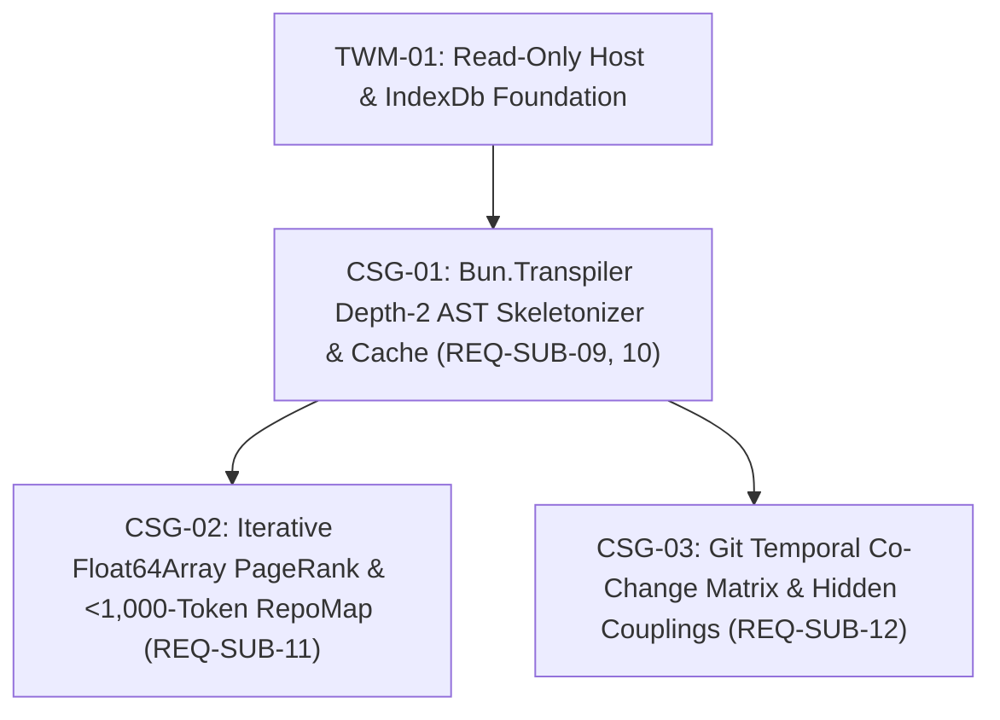

# Ticket Index: Phase E1.2 — `codebase-structural-graph`

- **Spec:** [`SPEC.md`](file:///Users/MAC/Documents/coding-projects/hivemind-substrate/.planning/phases/codebase-structural-graph/SPEC.md) (`REQ-SUB-09` .. `REQ-SUB-12`)
- **Independent Review:** [`../trajectory-working-memory/reviews/SPEC-REVIEW.md`](file:///Users/MAC/Documents/coding-projects/hivemind-substrate/.planning/phases/trajectory-working-memory/reviews/SPEC-REVIEW.md) (`PASS`)
- **ADRs:** [`ADR-003`](file:///Users/MAC/Documents/coding-projects/hivemind-substrate/.planning/architecture/ADR-003-bun-native-codebase-structural-graph.md)

## Dependency Graph & Frontier

| ID | Title | Requirements | Depends on | Write Lease | Automated Check | Status |
|---|---|---|---|---|---|---|
| [`CSG-01`](file:///Users/MAC/Documents/coding-projects/hivemind-substrate/.planning/phases/codebase-structural-graph/tickets/CSG-01-bun-transpiler-depth2-ast-skeletonizer-and-cache.md) | Zero-dependency `Bun.Transpiler` + Depth-2 closure-factory AST skeletonizer and content-addressed SQLite cache | `REQ-SUB-09`, `REQ-SUB-10` | `TWM-01` | `src/honeycomb/ast-skeleton.ts`, `src/honeycomb/index.ts`, `src/archive/index-db.ts`, `test/ast-skeleton.test.ts` | `bun test test/ast-skeleton.test.ts && bun run typecheck` | `todo` |
| [`CSG-02`](file:///Users/MAC/Documents/coding-projects/hivemind-substrate/.planning/phases/codebase-structural-graph/tickets/CSG-02-pagerank-repomap.md) | Iterative `Float64Array` CSR PageRank and `< 1,000`-token Tier-1 `RepoMap` | `REQ-SUB-11` | `CSG-01` | `src/honeycomb/pagerank.ts`, `src/honeycomb/index.ts`, `test/pagerank-cochange.test.ts` | `bun test test/pagerank-cochange.test.ts && bun run typecheck` | `todo` |
| [`CSG-03`](file:///Users/MAC/Documents/coding-projects/hivemind-substrate/.planning/phases/codebase-structural-graph/tickets/CSG-03-git-cochange-matrix-and-hidden-couplings.md) | Git temporal co-change matrix and hidden cross-boundary coupling alerts | `REQ-SUB-12` | `CSG-01` | `src/honeycomb/cochange.ts`, `src/honeycomb/index.ts`, `test/pagerank-cochange.test.ts` | `bun test test/pagerank-cochange.test.ts && bun run typecheck` | `todo` |
