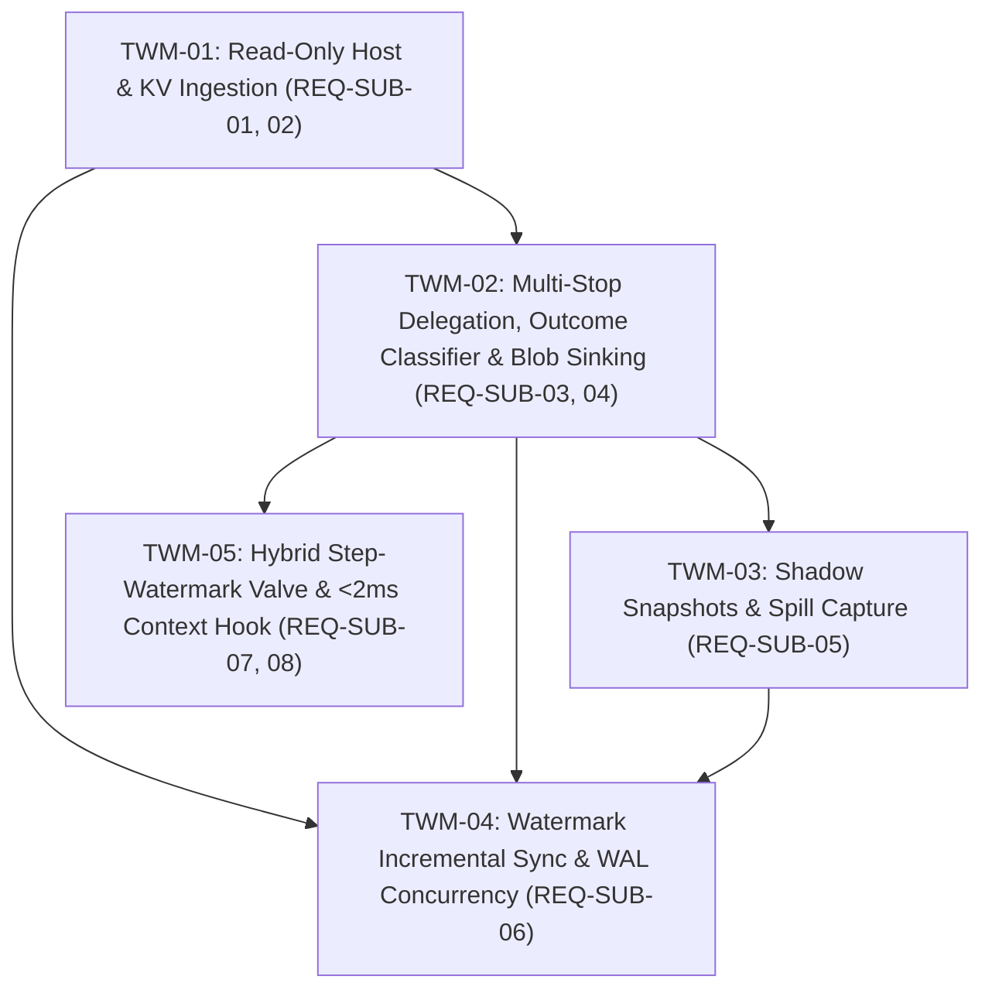

# Ticket Index: Phase E1.1 — `trajectory-working-memory`

- **Spec:** [`SPEC.md`](file:///Users/MAC/Documents/coding-projects/hivemind-substrate/.planning/phases/trajectory-working-memory/SPEC.md) (`REQ-SUB-01` .. `REQ-SUB-08`)
- **Independent Review:** [`reviews/SPEC-REVIEW.md`](file:///Users/MAC/Documents/coding-projects/hivemind-substrate/.planning/phases/trajectory-working-memory/reviews/SPEC-REVIEW.md) (`PASS`)
- **ADRs:** [`ADR-001`](file:///Users/MAC/Documents/coding-projects/hivemind-substrate/.planning/architecture/ADR-001-three-layer-context-substrate.md), [`ADR-002`](file:///Users/MAC/Documents/coding-projects/hivemind-substrate/.planning/architecture/ADR-002-step-watermark-valve-and-breadcrumb-handles.md)

## Dependency Graph & Frontier

| ID | Title | Requirements | Depends on | Write Lease | Automated Check | Status |
|---|---|---|---|---|---|---|
| [`TWM-01`](file:///Users/MAC/Documents/coding-projects/hivemind-substrate/.planning/phases/trajectory-working-memory/tickets/TWM-01-readonly-host-source-and-kv-ingestion.md) | Read-only host boundary, schema drift guard, and UTF-16BE `kv` binding ingestion | `REQ-SUB-01`, `REQ-SUB-02` | none | `src/archive/source.ts`, `src/archive/index-db.ts`, `src/archive/types.ts`, `src/spine/index.ts`, `test/source.test.ts` | `bun test test/source.test.ts && bun run typecheck` | `todo` |
| [`TWM-02`](file:///Users/MAC/Documents/coding-projects/hivemind-substrate/.planning/phases/trajectory-working-memory/tickets/TWM-02-multistop-delegation-outcome-classifier-and-blob-sinking.md) | Multi-stop `DelegationTurn` lineage, `ReportedOutcome` vs `VerifiedOutcome` classifier, and full message blob sinking | `REQ-SUB-03`, `REQ-SUB-04` | `TWM-01` | `src/archive/normalize.ts`, `src/archive/index-db.ts`, `src/archive/types.ts`, `src/honeycomb/index.ts`, `test/normalize.test.ts` | `bun test test/normalize.test.ts && bun run typecheck` | `todo` |
| [`TWM-03`](file:///Users/MAC/Documents/coding-projects/hivemind-substrate/.planning/phases/trajectory-working-memory/tickets/TWM-03-shadow-snapshots-and-external-spill-capture.md) | Shadow snapshot Git tree blob sinking and external `tool-output`/`shell` spill capture | `REQ-SUB-05` | `TWM-02` | `src/archive/snapshots.ts`, `src/archive/spills.ts`, `src/archive/index-db.ts`, `test/snapshots-spills.test.ts` | `bun test test/snapshots-spills.test.ts && bun run typecheck` | `todo` |
| [`TWM-04`](file:///Users/MAC/Documents/coding-projects/hivemind-substrate/.planning/phases/trajectory-working-memory/tickets/TWM-04-watermark-incremental-sync-and-wal-concurrency.md) | Watermark-gated incremental SQLite sync and `BEGIN IMMEDIATE` WAL concurrency | `REQ-SUB-06` | `TWM-01`, `TWM-02`, `TWM-03` | `src/archive/index.ts`, `src/archive/index-db.ts`, `test/persist.test.ts` | `bun test test/persist.test.ts && bun run typecheck` | `todo` |
| [`TWM-05`](file:///Users/MAC/Documents/coding-projects/hivemind-substrate/.planning/phases/trajectory-working-memory/tickets/TWM-05-hybrid-step-watermark-valve-and-in-memory-context-hook.md) | Hybrid assistant step-watermark `WorkingSetValve`, `< 2 ms` in-memory `context` hook, `FactBreadcrumb`s, and `WorkingMemoryManifest` | `REQ-SUB-07`, `REQ-SUB-08` | `TWM-02` | `src/archive/valve.ts`, `src/viewports/index.ts`, `test/valve.test.ts` | `bun test test/valve.test.ts && bun run typecheck` | `todo` |
