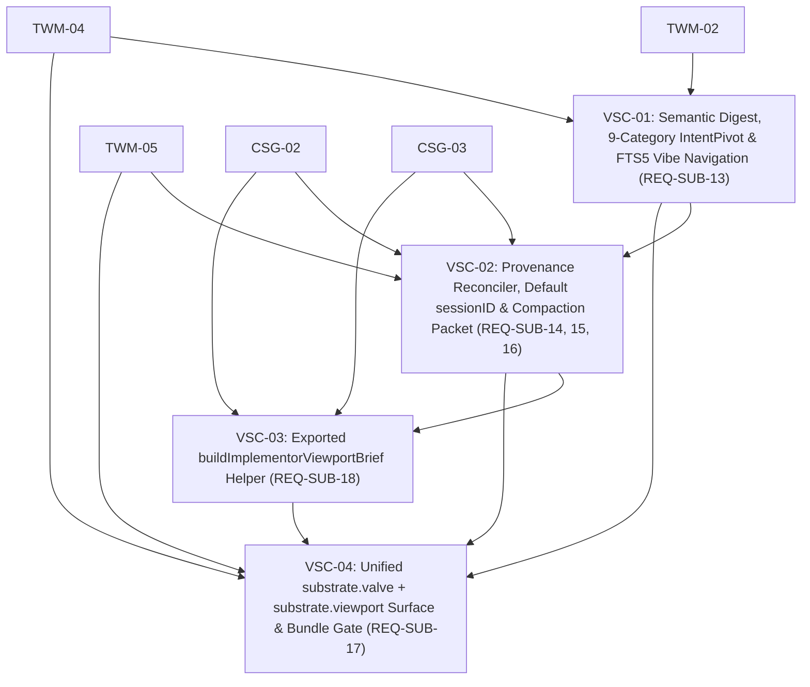

# Ticket Index: Phase E1.3 — `viewport-synthesis-compaction`

- **Spec:** [`SPEC.md`](file:///Users/MAC/Documents/coding-projects/hivemind-substrate/.planning/phases/viewport-synthesis-compaction/SPEC.md) (`REQ-SUB-13` .. `REQ-SUB-18`)
- **Independent Review:** [`../trajectory-working-memory/reviews/SPEC-REVIEW.md`](file:///Users/MAC/Documents/coding-projects/hivemind-substrate/.planning/phases/trajectory-working-memory/reviews/SPEC-REVIEW.md) (`PASS`)
- **ADRs:** [`ADR-001`](file:///Users/MAC/Documents/coding-projects/hivemind-substrate/.planning/architecture/ADR-001-three-layer-context-substrate.md), [`ADR-002`](file:///Users/MAC/Documents/coding-projects/hivemind-substrate/.planning/architecture/ADR-002-step-watermark-valve-and-breadcrumb-handles.md), [`ADR-003`](file:///Users/MAC/Documents/coding-projects/hivemind-substrate/.planning/architecture/ADR-003-bun-native-codebase-structural-graph.md)

## Dependency Graph & Frontier

| ID | Title | Requirements | Depends on | Write Lease | Automated Check | Status |
|---|---|---|---|---|---|---|
| [`VSC-01`](file:///Users/MAC/Documents/coding-projects/hivemind-substrate/.planning/phases/viewport-synthesis-compaction/tickets/VSC-01-semantic-digest-intent-pivots-and-fts5-vibe-navigation.md) | Semantic session digest, 9-category `IntentPivot` categorization, and FTS5 vibe navigation | `REQ-SUB-13` | `TWM-02`, `TWM-04` | `src/viewports/semantic-digest.ts`, `src/viewports/index.ts`, `test/semantic-digest.test.ts` | `bun test test/semantic-digest.test.ts && bun run typecheck` | `done` |
| [`VSC-02`](file:///Users/MAC/Documents/coding-projects/hivemind-substrate/.planning/phases/viewport-synthesis-compaction/tickets/VSC-02-provenance-reconciler-session-resolution-and-compaction-packet.md) | `ProvenanceChain` causal graph, `< 2 ms` live staleness reconciler, default `sessionID` resolution, and `CompactionContinuationPacket` | `REQ-SUB-14`, `REQ-SUB-15`, `REQ-SUB-16` | `TWM-05`, `CSG-02`, `CSG-03`, `VSC-01` | `src/viewports/continuity.ts`, `src/viewports/index.ts`, `test/continuity.test.ts` | `bun test test/continuity.test.ts && bun run typecheck` | `done` |
| [`VSC-03`](file:///Users/MAC/Documents/coding-projects/hivemind-substrate/.planning/phases/viewport-synthesis-compaction/tickets/VSC-03-implementor-viewport-brief-helper.md) | Exported cross-harness child delegation brief helper `buildImplementorViewportBrief` | `REQ-SUB-18` | `CSG-02`, `CSG-03`, `VSC-02` | `src/viewports/brief.ts`, `src/viewports/index.ts`, `test/brief.test.ts` | `bun test test/brief.test.ts && bun run typecheck` | `done` |
| [`VSC-04`](file:///Users/MAC/Documents/coding-projects/hivemind-substrate/.planning/phases/viewport-synthesis-compaction/tickets/VSC-04-unified-substrate-plugin-tools-hooks-and-bundle.md) | Unified two-tool plugin surface (`substrate.valve` + `substrate.viewport`), backwards-compatible aliases, lifecycle hooks, and single-file bundle gate | `REQ-SUB-17` | `TWM-04`, `TWM-05`, `VSC-01`, `VSC-02`, `VSC-03` | `src/plugin.ts`, `test/plugin.test.ts` | `bun test test/plugin.test.ts && bun run typecheck && bun run build` | `done` |
